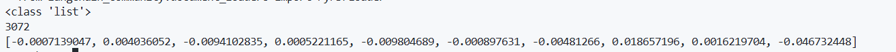

# Day 5  Building My First Retrieval-Augmented Generation (RAG) Pipeline

## Objective

The objective of today's session was to build the core components of a Retrieval-Augmented Generation (RAG) pipeline. I learned how external documents are processed, converted into vector embeddings, stored inside a vector database, and finally used by a Large Language Model (LLM) to generate grounded responses.

---

#  Topics Covered

## 1. Document Loading

The first step of the RAG pipeline is loading external documents. I used LangChain's `PyPDFLoader` to read a PDF file and convert each page into a Document object.

### Code

```python
from langchain_community.document_loaders import PyPDFLoader

loader = PyPDFLoader("HR_Policy.pdf")
documents = loader.load()
```

### Output

```text
Document(
page_content="ABC Company Human Resources Policy...",
metadata={
    'source':'HR_Policy.pdf',
    'page':0
}
)
```


---

## 2. Understanding Document Objects

LangChain stores every page as a **Document Object** instead of plain text.

Each document contains:

- `page_content`
- `metadata`

The metadata stores useful information such as:

- Source file
- Page number
- Document title

---

## 3. Text Chunking

Large documents cannot be embedded efficiently, so they are divided into smaller chunks using LangChain's `RecursiveCharacterTextSplitter`.

### Configuration

- Chunk Size = **300**
- Chunk Overlap = **50**

### Code

```python
from langchain_text_splitters import RecursiveCharacterTextSplitter

text_splitter = RecursiveCharacterTextSplitter(
    chunk_size=300,
    chunk_overlap=50
)

chunks = text_splitter.split_documents(documents)
```

### Output

```text
Number of Pages : 2
Number of Chunks : 11
```

### Learning

Chunk overlap helps preserve context when a sentence is split between two chunks.


---

## 4. Generating Embeddings

The embedding model converts plain text into numerical vectors so that semantic similarity can be calculated.

I used Google's Gemini Embedding Model.

### Code

```python
from langchain_google_genai import GoogleGenerativeAIEmbeddings

embeddings = GoogleGenerativeAIEmbeddings(
    model="gemini-embedding-2-preview"
)

vector = embeddings.embed_query(chunks[0].page_content)
```

### Output

```text
<class 'list'>

3072
```

### Learning

Each document chunk is converted into a **3072-dimensional vector**, allowing the vector database to compare semantic meaning instead of keywords.




---

## 5. Creating the Vector Database (ChromaDB)

The generated embeddings were stored inside ChromaDB.

### Code

```python
from langchain_chroma import Chroma

db = Chroma.from_documents(
    documents=chunks,
    embedding=embeddings,
    persist_directory="./chroma_db"
)
```

### Output

```text
Vector Database Created Successfully!
```

### Learning

ChromaDB stores:

- Embeddings
- Original text chunks
- Metadata

This enables fast semantic retrieval without rebuilding embeddings every time.


---

## 6. Retrieval Pipeline

The application retrieves the most relevant chunks using semantic similarity search.

### Code

```python
docs = db.similarity_search(question, k=3)
```

### RAG Retrieval Flow

```text
User Question
      │
      ▼
Question Embedding
      │
      ▼
ChromaDB
      │
      ▼
Top 3 Relevant Chunks
```

---

## 7. Integrating Gemini LLM

The retrieved chunks are combined into a prompt and passed to the Gemini LLM to generate a grounded answer.

### Code

```python
context = "\n\n".join(
    [doc.page_content for doc in docs]
)

response = llm.invoke(prompt)
```

---

## 8. First Working RAG Chatbot

Successfully tested the chatbot with the following question.

### Input

```text
How many maternity leaves are allowed?
```

### Output

```text
Eligible female employees are entitled to 26 weeks of fully paid maternity leave.
```

This confirmed that the complete Retrieval-Augmented Generation pipeline was functioning correctly.


---

# Complete RAG Pipeline

```text
                 PDF
                  │
                  ▼
          Document Loader
                  │
                  ▼
          Document Objects
                  │
                  ▼
           Text Chunking
                  │
                  ▼
        Gemini Embeddings
                  │
                  ▼
             ChromaDB
═══════════════════════════════════════
           User Question
                  │
                  ▼
      Question Embedding
                  │
                  ▼
        Similarity Search
                  │
                  ▼
      Top Relevant Chunks
                  │
                  ▼
            Gemini LLM
                  │
                  ▼
           Final Answer
```

---

# Challenges Faced

## 1. LangChain Deprecation Warning

### Error

```text
DeprecationWarning:
langchain-community is being sunset.
```

### Reason

LangChain is gradually moving integrations into standalone packages.

### Resolution

Continued using the package since it is still supported for development.

---

## 2. Embedding Model Not Found

### Error

```text
404 NOT_FOUND
models/embedding-001
```

### Reason

The model name had changed.

### Resolution

Updated the embedding model to:

```python
model="gemini-embedding-2-preview"
```

---

## 3. Google API Key Error

### Error

```text
API key required
```

### Reason

The Gemini API key was not loaded before creating the embedding model.

### Resolution

Configured the `GOOGLE_API_KEY` environment variable before initializing the embedding model.

---

## 4. Google Service Unavailable

### Error

```text
503 UNAVAILABLE
```

### Reason

Temporary Google embedding service outage.

### Resolution

Retried the request after verifying package versions. The service became available and indexing completed successfully.

---

## 5. Project Structure Confusion

Initially, there was confusion regarding the separation of `index.py` and `app.py`.

### Resolution

Understood the responsibilities of both files:

- `index.py` → Build and update the vector database.
- `app.py` → Query the vector database and generate responses.

---

# Key Learnings

- Understood the difference between Document Objects and plain text.
- Learned why chunking is required in RAG.
- Learned the importance of chunk overlap.
- Understood how embedding models convert text into vectors.
- Learned how ChromaDB stores embeddings and metadata.
- Performed semantic similarity search using vector embeddings.
- Built an end-to-end Retrieval-Augmented Generation (RAG) pipeline.
- Successfully integrated Gemini LLM with ChromaDB for grounded question answering.

---

# Technologies Used

- Python
- LangChain
- PyPDFLoader
- RecursiveCharacterTextSplitter
- Google Gemini Embeddings
- Google Gemini 2.5 Flash
- ChromaDB

---

# Project Structure

```text
RAG/
│
├── app.py
├── index.py
├── HR_Policy.pdf
├── chroma_db/
│   ├── chroma.sqlite3
│   └── ...
└── requirements.txt
```

---

# Outcome

Successfully built a working Retrieval-Augmented Generation (RAG) application capable of:

- Loading PDF documents
- Splitting documents into semantic chunks
- Generating vector embeddings
- Storing vectors inside ChromaDB
- Retrieving relevant document chunks
- Generating grounded answers using the Gemini LLM

---

# Next Steps

- Explore similarity search in depth.
- Understand cosine similarity and Top-K retrieval.
- Improve prompt construction.
- Support multiple PDF documents.
- Build a Streamlit-based chatbot interface.
- Refactor the project into a production-ready architecture.
