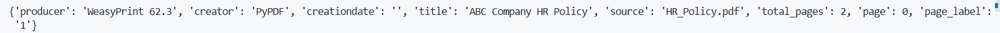
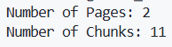

# Day 13 - Document Loading, Document Objects and Text Chunking for RAG

## Date

8 July 2026

## Topics Covered

- Document Loading
- PyPDFLoader
- Document Objects
- Metadata
- Text Chunking
- RecursiveCharacterTextSplitter
- Chunk Size and Chunk Overlap

## Learning Summary

On the thirteenth day of the training, our mentor guided us through the initial stages of building a **Retrieval-Augmented Generation (RAG)** pipeline. The session focused on preparing external documents so that they could be efficiently processed and retrieved by Large Language Models.

The first step covered was **Document Loading**. We learned how external documents such as PDF files are imported into a RAG application using LangChain's **PyPDFLoader**. Instead of treating the entire PDF as plain text, the loader reads each page separately and converts it into structured document objects that can be processed further.

### Code

```python
from langchain_community.document_loaders import PyPDFLoader

loader = PyPDFLoader("HR_Policy.pdf")
documents = loader.load()
```

### Output

```text
Document(
page_content="ABC Company Human Resources Policy...",
metadata={
    'source':'HR_Policy.pdf',
    'page':0
}
)
```

### Learning

Each page of the PDF is converted into a **Document Object**, which contains both the page content and useful metadata.



---

The mentor then explained the structure of **Document Objects** in LangChain. Every document consists of two important components:

- **page_content** – stores the textual content of the page.
- **metadata** – stores additional information such as the source file name, page number, and other document details.

This structured representation allows AI applications to identify where retrieved information originates, improving traceability and explainability.

The session then moved to **Text Chunking**, an essential preprocessing step in Retrieval-Augmented Generation. Since embedding models and LLMs cannot efficiently process very large documents at once, documents are divided into smaller chunks before generating embeddings.

We learned how LangChain's **RecursiveCharacterTextSplitter** creates overlapping chunks while preserving the context between adjacent sections of the document.

### Configuration

- Chunk Size = **300**
- Chunk Overlap = **50**

### Code

```python
from langchain_text_splitters import RecursiveCharacterTextSplitter

text_splitter = RecursiveCharacterTextSplitter(
    chunk_size=300,
    chunk_overlap=50
)

chunks = text_splitter.split_documents(documents)
```

### Output

```text
Number of Pages : 2

Number of Chunks : 11
```

### Learning

Chunk overlap preserves context when information spans across multiple chunks, resulting in more accurate retrieval during question answering.



---

Throughout the practical demonstration, the mentor emphasized that proper document loading and chunking form the foundation of an effective RAG system. Well-structured document chunks significantly improve retrieval quality and ultimately lead to more accurate AI-generated responses.

## Key Takeaways

- External documents are loaded into LangChain using **PyPDFLoader**.
- Every page is converted into a structured **Document Object**.
- Metadata stores useful information such as source file and page number.
- Large documents are divided into smaller chunks before generating embeddings.
- Chunk overlap helps preserve contextual information between consecutive chunks.
- Effective document preprocessing improves the overall performance of a RAG application.

## Outcome

By the end of the thirteenth day, I understood how documents are loaded, represented as Document Objects, and divided into semantic chunks before embedding generation. These preprocessing steps provided the foundation for the next stage of the RAG pipeline, where document chunks would be converted into vector embeddings and stored in a vector database for semantic retrieval.
