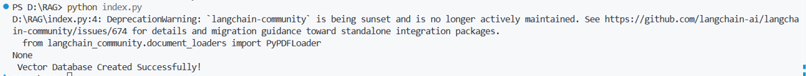

# Day 14 - Generating Embeddings, Creating a Vector Database and Semantic Retrieval

## Date

9 July 2026

## Topics Covered

- Generating Embeddings
- Google Gemini Embedding Model
- ChromaDB
- Vector Database
- Semantic Similarity Search
- Retrieval Pipeline

## Learning Summary

On the fourteenth day of the training, our mentor explained the next stage of building a **Retrieval-Augmented Generation (RAG)** pipeline. After preparing and chunking the documents, the focus shifted to converting those text chunks into vector embeddings and storing them inside a vector database for efficient semantic retrieval.

The session began with **Generating Embeddings**. We learned that embedding models transform textual information into high-dimensional numerical vectors that capture the semantic meaning of the content. Instead of comparing documents based on exact keywords, these vectors allow AI systems to retrieve information based on contextual similarity.

For the implementation, we used **Google Gemini Embeddings** to generate vector representations for each document chunk.

### Code

```python
from langchain_google_genai import GoogleGenerativeAIEmbeddings

embeddings = GoogleGenerativeAIEmbeddings(
    model="gemini-embedding-2-preview"
)

vector = embeddings.embed_query(chunks[0].page_content)
```

### Output

```text
<class 'list'>

3072
```

### Learning

Each document chunk was converted into a **3072-dimensional embedding vector**, enabling semantic comparison between documents instead of simple keyword matching.


---

The mentor then introduced **ChromaDB**, an open-source vector database used to store document embeddings along with their original content and metadata. We learned that vector databases make semantic retrieval efficient by indexing embeddings and allowing similarity-based searches.

### Code

```python
from langchain_chroma import Chroma

db = Chroma.from_documents(
    documents=chunks,
    embedding=embeddings,
    persist_directory="./chroma_db"
)
```

### Output

```text
Vector Database Created Successfully!
```

### Learning

ChromaDB stores:

- Document embeddings
- Original document chunks
- Associated metadata

This allows the application to retrieve relevant information quickly without regenerating embeddings each time a query is received.



---

After creating the vector database, we explored the concept of **Semantic Similarity Search**. The mentor explained that when a user submits a question, it is first converted into an embedding. The vector database then compares this query embedding with the stored document embeddings and retrieves the most relevant chunks based on semantic similarity.

### Code

```python
docs = db.similarity_search(question, k=3)
```

### Retrieval Workflow

```text
User Question
      │
      ▼
Question Embedding
      │
      ▼
ChromaDB
      │
      ▼
Top 3 Relevant Chunks
```

The mentor emphasized that this retrieval process enables RAG systems to provide accurate and contextually relevant information without relying solely on the model's pre-trained knowledge.

Overall, today's session demonstrated how embeddings, vector databases, and semantic retrieval work together to provide the external knowledge required for grounded AI responses.

## Key Takeaways

- Embedding models convert text into high-dimensional numerical vectors.
- Google Gemini Embeddings capture the semantic meaning of document content.
- ChromaDB stores embeddings, document chunks, and metadata efficiently.
- Vector databases enable fast semantic similarity searches.
- User queries are converted into embeddings before retrieval.
- Semantic retrieval improves the accuracy and relevance of AI-generated responses.

## Outcome

By the end of the fourteenth day, I learned how document chunks are transformed into vector embeddings using the Google Gemini Embedding Model and stored inside ChromaDB. I also understood how semantic similarity search retrieves the most relevant information, preparing the final stage of the RAG pipeline where retrieved documents are used by the Large Language Model to generate grounded responses.
