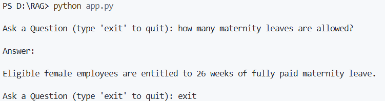

# Day 15 - Integrating Gemini LLM and Completing the Retrieval-Augmented Generation (RAG) Pipeline

## Date

10 July 2026

## Topics Covered

- Integrating Gemini LLM
- Context Construction
- End-to-End RAG Workflow
- Testing the RAG Application
- Project Structure
- Challenges Faced
- Complete RAG Pipeline

## Learning Summary

On the fifteenth day of the training, our mentor demonstrated the final stage of building a **Retrieval-Augmented Generation (RAG)** application by integrating the **Gemini Large Language Model (LLM)** with the retrieval pipeline. After retrieving the most relevant document chunks from ChromaDB, these chunks were combined to create contextual information, which was then provided to the Gemini model for generating accurate and grounded responses.

The mentor explained that once semantic retrieval is completed, the retrieved document chunks are merged into a single context before being sent to the LLM. This ensures that the model generates answers based on verified information retrieved from the knowledge base rather than relying only on its pre-trained knowledge.

### Code

```python
context = "\n\n".join(
    [doc.page_content for doc in docs]
)

response = llm.invoke(prompt)
```

---

We then observed the **complete Retrieval-Augmented Generation workflow**, where a user's query passes through multiple stages before producing the final response. Unlike a traditional chatbot, the RAG application first retrieves the most relevant information from the vector database and then uses the Gemini model to generate a context-aware answer.

### Complete RAG Pipeline

```text
                 PDF
                  │
                  ▼
          Document Loader
                  │
                  ▼
          Document Objects
                  │
                  ▼
           Text Chunking
                  │
                  ▼
        Gemini Embeddings
                  │
                  ▼
             ChromaDB
═══════════════════════════════════════
           User Question
                  │
                  ▼
      Question Embedding
                  │
                  ▼
        Similarity Search
                  │
                  ▼
      Top Relevant Chunks
                  │
                  ▼
            Gemini LLM
                  │
                  ▼
           Final Answer
```

---

The mentor demonstrated the working application by asking questions related to the uploaded PDF document. The system successfully retrieved the most relevant document chunks from ChromaDB and generated responses using the Gemini model.

### Example

**Input**

```text
How many maternity leaves are allowed?
```

**Output**

```text
Eligible female employees are entitled to 26 weeks of fully paid maternity leave.
```



---

The session also included a discussion of some common challenges encountered while building the RAG application. We learned about issues such as API key configuration, embedding model version changes, temporary service availability errors, and the separation of indexing and application logic. The mentor explained how these issues can be identified and resolved during development.

We also reviewed the overall project organization, understanding that separating the indexing process from the application logic makes the project easier to maintain and update as new documents are added.

### Project Structure

```text
RAG/

├── app.py
├── index.py
├── HR_Policy.pdf
├── chroma_db/
│   ├── chroma.sqlite3
│   └── ...
└── requirements.txt
```

Overall, today's session brought together all the concepts learned during the previous days and demonstrated how document loading, chunking, embeddings, vector databases, semantic retrieval, and Large Language Models work together to build a complete Retrieval-Augmented Generation system.

## Challenges Faced

- Understanding the separation between `index.py` and `app.py`.
- Configuring the Google API key correctly before accessing Gemini services.
- Resolving embedding model version changes.
- Handling temporary service availability issues during indexing.

## Key Takeaways

- Retrieved document chunks are provided as context to the Gemini LLM before response generation.
- Combining retrieval with LLMs produces more accurate and grounded answers.
- A complete RAG pipeline includes document loading, chunking, embedding generation, vector storage, semantic retrieval, and LLM response generation.
- Proper project structure improves maintainability and scalability.
- Understanding common implementation challenges helps build more reliable AI applications.

## Outcome

By the end of the fifteenth day, I successfully understood the complete workflow of a Retrieval-Augmented Generation (RAG) system. I learned how Gemini LLM integrates with semantic retrieval to generate grounded responses using external knowledge and gained a clear understanding of the architecture and components required to build reliable AI-powered question-answering applications.
